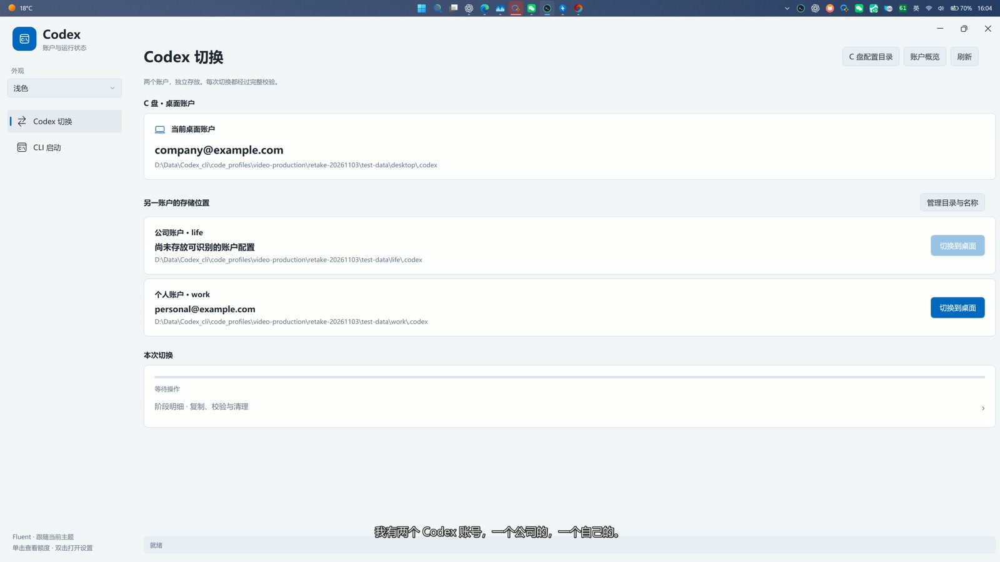

# Codex Account Switcher

[简体中文](README.md) | [English](README.en.md)

A portable Windows utility with a Windows 11 style interface for switching local Codex desktop accounts and launching Codex CLI with a separate account.

## See it in action



Read the [illustrated product guide](docs/PRODUCT_GUIDE.en.md) for account directories, CLI launching, quota previews, tray controls, themes, migration recovery, and resource usage. Screenshots use example accounts; quota values are demonstration data.

## Install PowerToys for file lock handling

Before using the PowerToys file lock inspection and process termination integration, install [Microsoft PowerToys](https://github.com/microsoft/PowerToys) and enable **File Locksmith** in its settings. [Download PowerToys from GitHub](https://github.com/microsoft/PowerToys/releases/latest). PowerToys is installed separately and is not bundled with either distribution.

## Get started

Download the portable ZIP or EXE installer from [Releases](https://github.com/Liu020321/CodexAccountSwitcher/releases/tag/v7.2.7). Extract the ZIP and run `CodexSettings.exe`, or install for the current Windows user. Requires Windows 11 x64 and .NET Framework 4.8. Install the official Codex CLI separately.

- Switch complete desktop configuration directories using staging copies, verification, recovery records, and rollback.
- Resume with the last saved overall progress, including after restarting the app. Verified copies are reused; changed files are copied again.
- Launch CLI with an account different from the desktop account using a temporary `CODEX_HOME` in a new terminal.
- Single-click the tray icon for quotas, double-click for settings, and right-click for the exit menu.
- Query quotas when the preview opens, with a three-minute cache. The quota ring reflects the latest result without background quota polling.

See [Usage](USAGE.en.md). Share the original release archive, not a folder containing your accounts, settings, or logs. This documentation is bilingual; the application interface remains in Chinese.

## Build and verify

Run in Windows PowerShell:

```powershell
powershell -ExecutionPolicy Bypass -File .\build.ps1
.\CodexSettings.exe --self-test
.\CodexSettings.exe --ui-test
```

The default build is portable. Tests use temporary fictional accounts; UI tests open test windows. Exit applications using the affected configuration before switching. If locks or verification failures occur, follow recovery instructions and do not force-delete the source.

To package a release, run `package.ps1 -OutputDirectory <new output directory> -IsccPath <path to ISCC.exe>`. Packaging uses a file allowlist and excludes used account directories and settings. See the [v7.2.7 validation record (Chinese)](docs/VALIDATION-v7.2.7.md).

## Attribution and licensing

Maintained by Liu020321 and developed with AI coding assistance. The interface takes design inspiration from Microsoft PowerToys and Windows 11 Fluent. This is not an official Microsoft or OpenAI product. Icons are drawn by project code; system fonts are not redistributed. See [third-party notices](THIRD_PARTY_NOTICES.md).

No open-source license has currently been granted for the source code. Public source availability permits viewing; contact the maintainer about permission before copying, modifying, or redistributing source code. The original portable release is provided for downloading and sharing.

## Privacy and security

Release packages do not contain the author's accounts, credentials, chat history, or personal logs. Running the software reads the user's local authentication configuration; generated settings and logs may contain local paths and should not be published.

The app runs without elevation by default. Process termination and elevation are initiated by the user. It has no designed telemetry upload, remote control, or network listener; quota queries are performed through the separately installed official Codex CLI. The software is unsigned and has not undergone a comprehensive independent security audit. Zero vulnerabilities or absolute security cannot be guaranteed.
