# Codex Account Switcher · Illustrated product guide

[简体中文](PRODUCT_GUIDE.md) | [English](PRODUCT_GUIDE.en.md)

Keep company and personal work separate: use one account in Codex desktop and another in CLI, or exchange the desktop account after exiting applications using its configuration. This guide describes the existing Chinese application interface.

Screenshots come from the demonstration video and test interface. They use example identities such as company@example.com and personal@example.com. Quotas are demonstration values; recorded interfaces may differ slightly from the current version.

## Install PowerToys

Install [Microsoft PowerToys](https://github.com/microsoft/PowerToys) and enable File Locksmith for the external file lock inspection and process termination integration. [Download from GitHub](https://github.com/microsoft/PowerToys/releases/latest). It is a separate installation and is not included in the release packages.

## 1. Know which account you are using

The home screen separates the current desktop identity from the other account's storage location, showing its email, configuration path, and switch action. Two main navigation pages cover desktop switching and CLI launching.

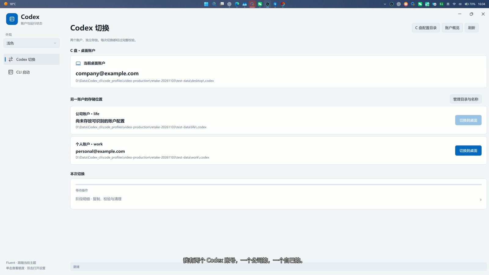

Identities are read from local configuration. Desktop and CLI accounts must differ. Quotas are shared by account; using a second client does not grant extra quota.

## 2. Manage account directories

Select an account folder or parent directory, then set two sibling directories and their display names. Changing a display name does not rename the disk folder.

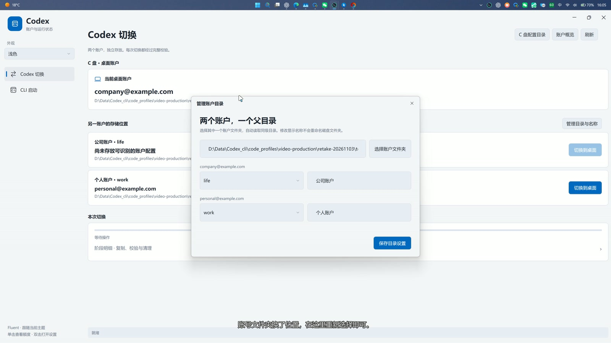

Suggested layout:

```text
Accounts/
  life/.codex/
  work/.codex/
```

The original portable package includes only empty account folders. Select your own configuration locations. After moving them, select the new path. Resolve any unfinished migration before manually deleting staging copies.

## 3. Launch CLI in the project folder

The CLI page selects an account different from the desktop account. Choose PowerShell or CMD and a project folder, then launch.

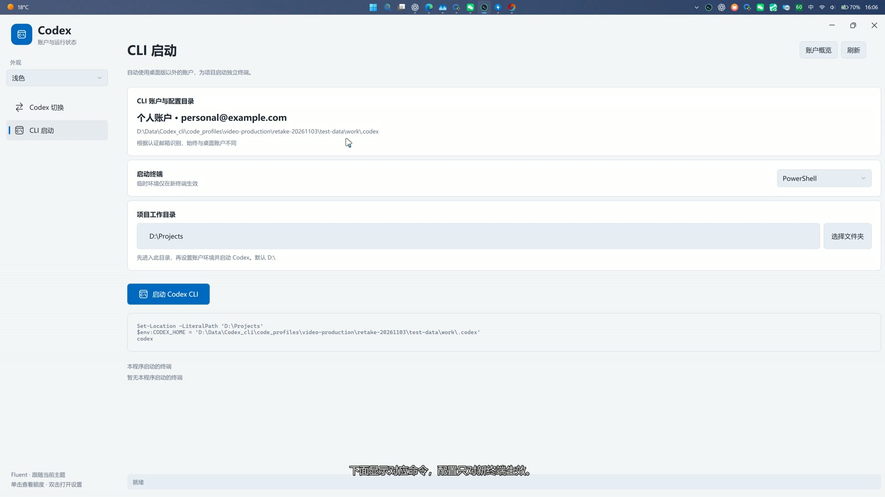

The sequence is **enter project folder → set temporary CODEX_HOME → start codex**. The default project folder is the root of drive D. For example:

```powershell
Set-Location -LiteralPath 'D:\Projects\MyProject'
$env:CODEX_HOME = 'D:\Accounts\personal\.codex'
codex
```

The project directory and account configuration directory serve different purposes. The environment setting applies only to the new terminal and does not change permanent Windows environment variables. Install the official Codex CLI separately.

## 4. Preview account quotas

Single-click the tray icon for the five-hour and weekly remaining quotas, reset times, and last update. Click outside to dismiss; double-click the icon for settings.

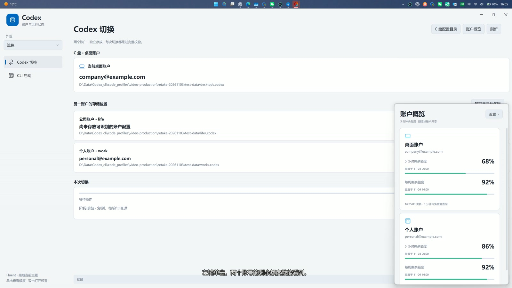

Queries run when the preview opens, with a three-minute cache and no background quota polling. The ring reflects the last retrieved five-hour quota of the non-desktop account and changes after updated data is retrieved.

| Remaining quota | Bar color |
|---|---|
| 0–20% | Red |
| Above 20%, up to 50% | Yellow |
| Above 50% | Green |

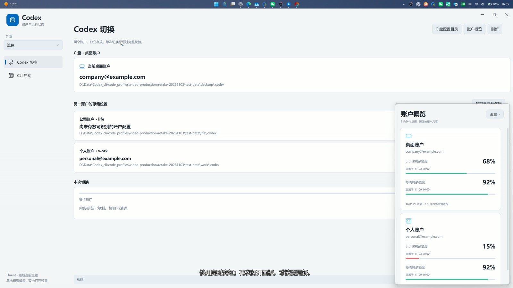

Demonstration quota changes illustrate feedback, not real consumption speed. An unread quota is unknown, not zero.

## 5. Tray controls and themes

Right-click for preview, settings, usage instructions, and exit. Clicking outside dismisses the menu; leaving it for about 1.5 seconds also dismisses it.

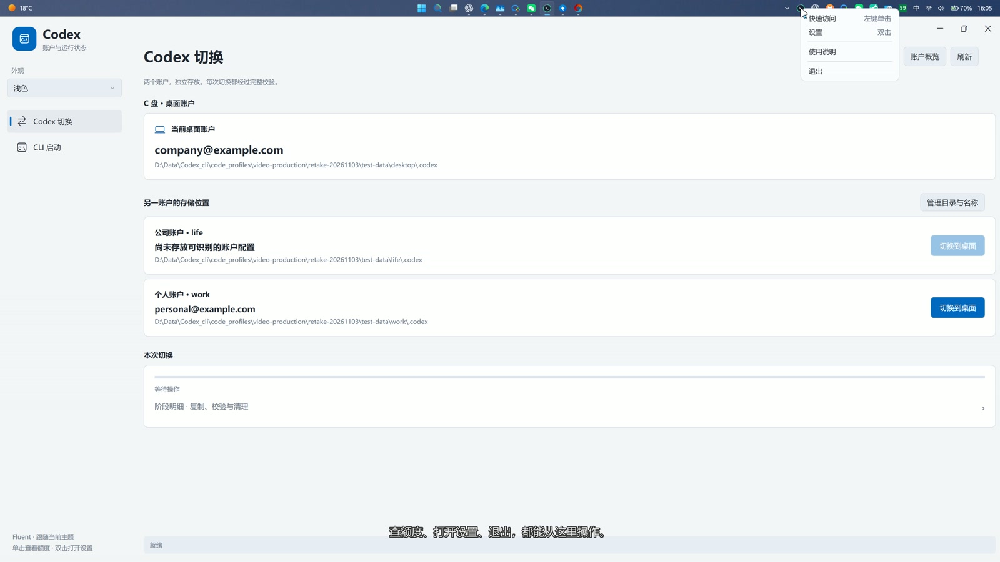

Choose the Windows system theme, light, or dark. Rounded cards, dropdowns, thin scrollbars, and caption buttons share a consistent style. The interface uses Microsoft YaHei. Theme changes do not change accounts.

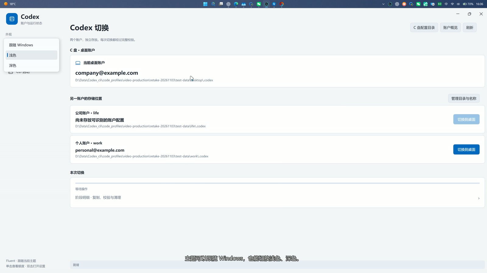

## 6. Switch complete configurations and recover progress

The desktop configuration lives in `.codex` under the current Windows user profile. The app migrates the complete configuration, placing the other account there and returning the original account to its storage location.

Replacing only `auth.json` may change the identity, but mismatched session data can cause blank or inaccessible chats. Moving the full directory keeps authentication and local session data together; it does not change server permissions or grant access to another account's chats.

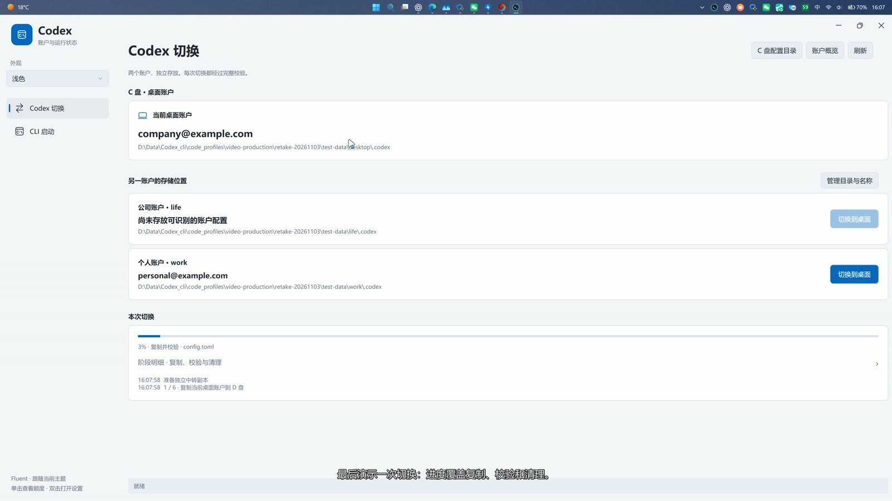

Overall progress covers staging copies, verification, committing, and cleanup. Expand the initially collapsed details to see stages and logs. Follow the interface to resume or roll back interrupted operations.

Resuming preserves the last saved overall percentage, including after restarting. Matching verified files are reused and changed files are recopied when the full source remains available. Progress may pause during verification. This is file-level recovery, not a byte offset within an unfinished file; that file is copied again. Completion resets the operation state.

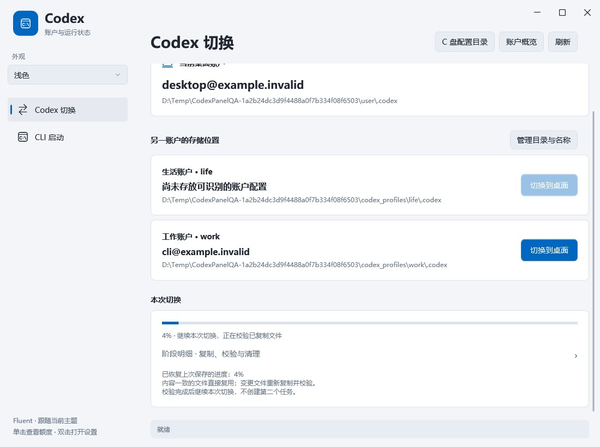

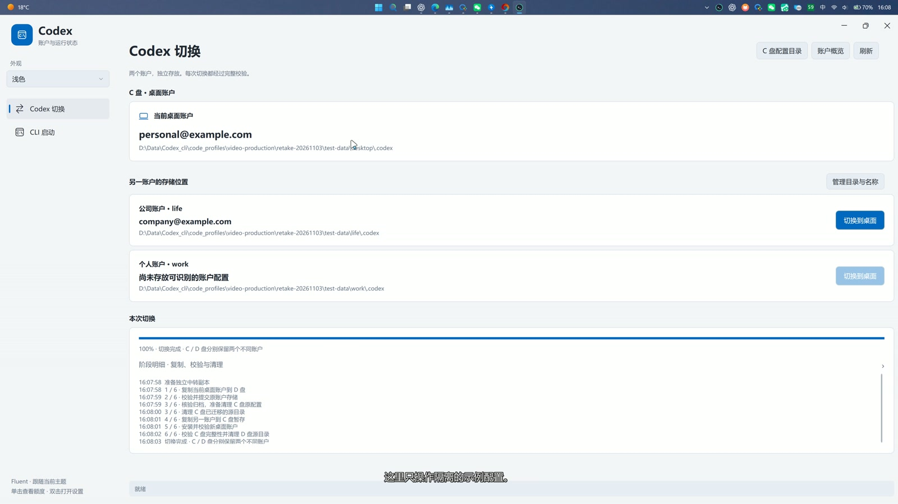

Exit applications using the configuration before switching. Stop and follow the displayed instructions for lock, permission, path, or verification errors. Terminating processes may interrupt unsaved work. An empty lock scan is not proof that moving is safe. Do not force-delete source configurations to bypass errors.

## 7. Foreground and tray resource usage

The recording measures the settings window open and the application tucked away in the tray separately. Hidden-window usage should not be presented as foreground usage.

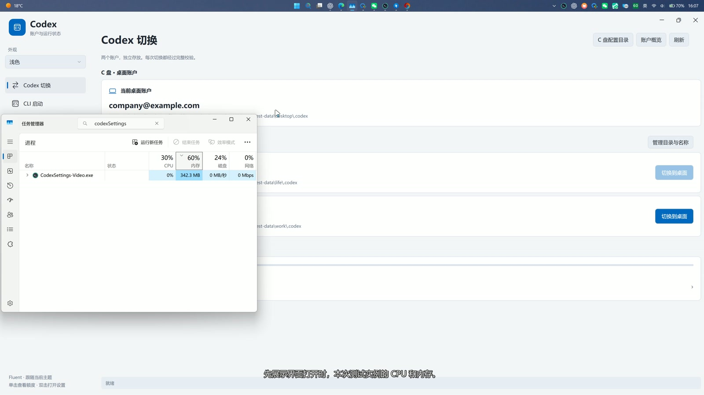

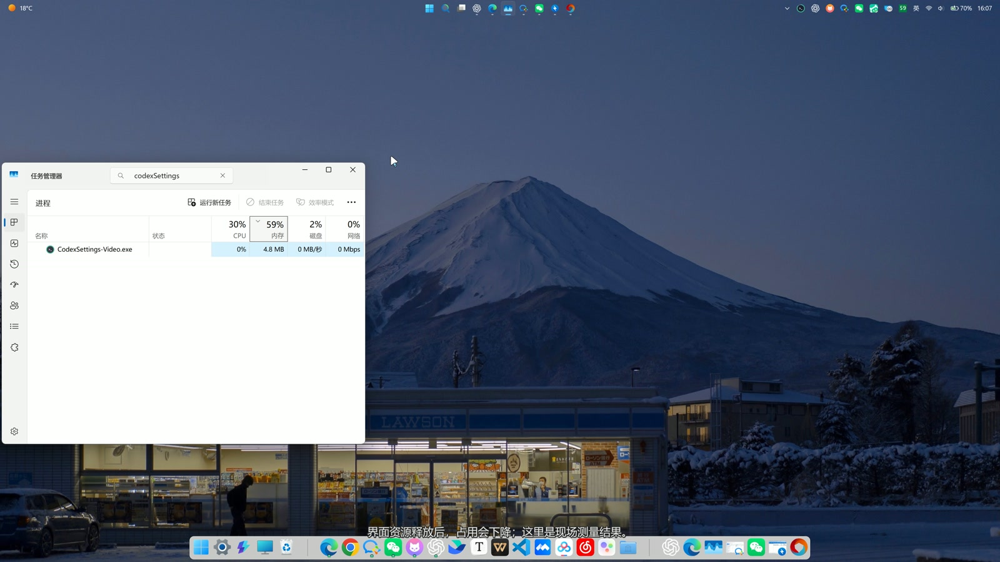

The design avoids background quota polling and continuously redrawing the quota icon, and releases relevant resources after idle windows close. These screenshots are individual recorded measurements, not guaranteed memory limits. Hardware, caches, visible windows, and migration tasks affect results. A running tray application still retains necessary state.

## 8. Download and share safely

Download the original portable ZIP or EXE installer from [Releases](https://github.com/Liu020321/CodexAccountSwitcher/releases). Requires Windows 11 x64 and .NET Framework 4.8, with Codex CLI installed separately. The installer installs for the current user in LocalAppData without requiring administrator rights.

Configure your account directories before launching. Share the original ZIP or installer and checksum file, not your used program folder. Credentials, chats, settings, and personal logs must remain private.

Uninstallation removes distributed files while retaining user-created accounts, settings, and logs. Resolve unfinished migrations before removing recovery files. The app is unsigned and has not undergone a comprehensive independent security audit; zero vulnerabilities cannot be promised. See [third-party notices](../THIRD_PARTY_NOTICES.md).
