# Codex Account Switcher · 产品功能与图文指南

一个 Windows 11 风格的本地账户管理工具：桌面版使用一个账户，CLI 使用另一个账户。适合将公司项目与个人项目分开管理，也能在退出相关程序后交换桌面账户。

本文截图取自软件演示视频与新版测试界面，使用 company@example.com、personal@example.com、desktop@example.invalid 等示例账户。截图中的额度为演示数据；不包含真实登录凭证。录制界面与当前版本可能有细节差异。

## 1. 两个账户，一眼分清

主界面区分当前桌面账户与另一账户的存储位置，展示邮箱、配置路径和切换入口。左侧只保留“Codex 切换”和“CLI 启动”两个主要功能页，减少寻找操作的成本。

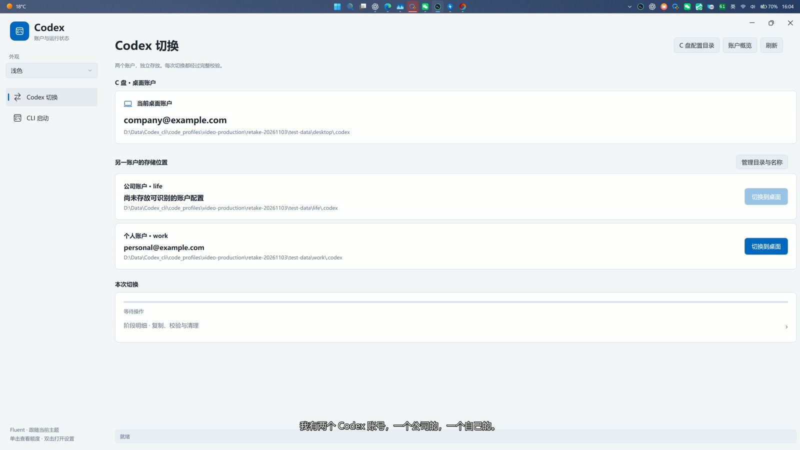

**亮点：**账户信息从本机配置读取，不预设使用者邮箱；桌面与 CLI 账户必须不同。账户切换与额度展示是不同功能，额度按账户共享，并不是为每个客户端额外增加额度。

## 2. 配置目录集中管理

在“管理目录与名称”中选择一个账户文件夹或父目录，再指定两个同级目录及显示名称。显示名称便于区分公司、个人等用途，修改显示名称不会重命名磁盘文件夹。

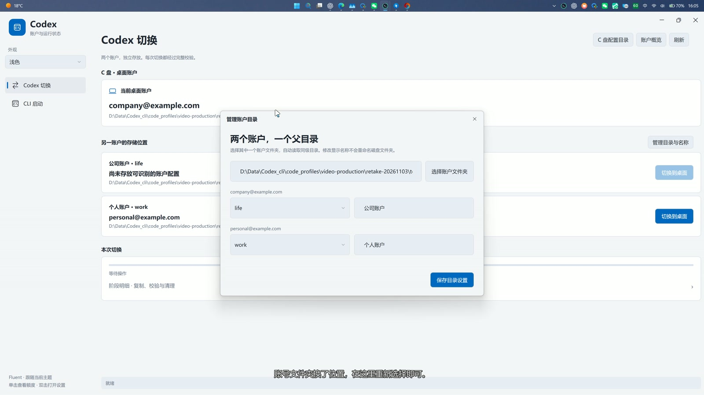

建议目录结构：

```text
账户父目录/
  life/.codex/
  work/.codex/
```

首次运行便携版后，请选择自己的账户目录。原始分享包中的 accounts 目录为空，不附带任何已登录账户。移动过账户文件夹后，应重新选择当前路径；有未完成切换时先按恢复提示处理，避免直接删除中转副本。

## 3. CLI 一键启动，项目目录独立选择

CLI 页面自动选择与桌面不同的另一账户。选择 PowerShell 或 CMD，再指定要处理的项目文件夹，点击启动即可。

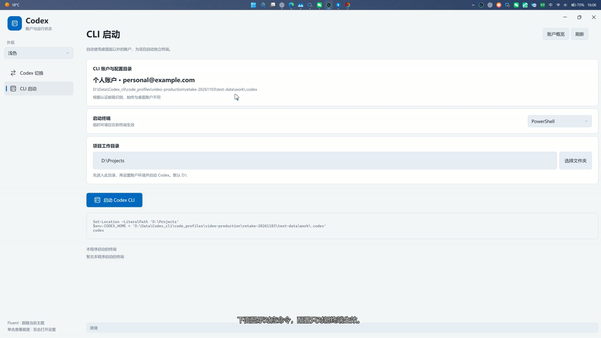

启动顺序是：**进入项目工作目录 → 设置新终端的临时 CODEX_HOME → 启动 codex**。默认项目目录为 D 盘根目录，可通过“选择文件夹”修改。

PowerShell 的等价示例：

```powershell
Set-Location -LiteralPath 'D:\Projects\MyProject'
$env:CODEX_HOME = 'D:\Accounts\personal\.codex'
codex
```

CODEX_HOME 指向账户配置目录，工作目录指向项目，两者用途不同。环境变量仅作用于新终端，不修改系统永久环境变量。需要事先自行安装官方 Codex CLI，并确保命令可被找到。

## 4. 单击托盘，快速查看两个账户额度

左键单击托盘图标即可打开账户概览，查看五小时和每周剩余额度、重置时间与最近更新时间。点击面板外部可收起；双击托盘图标打开设置。

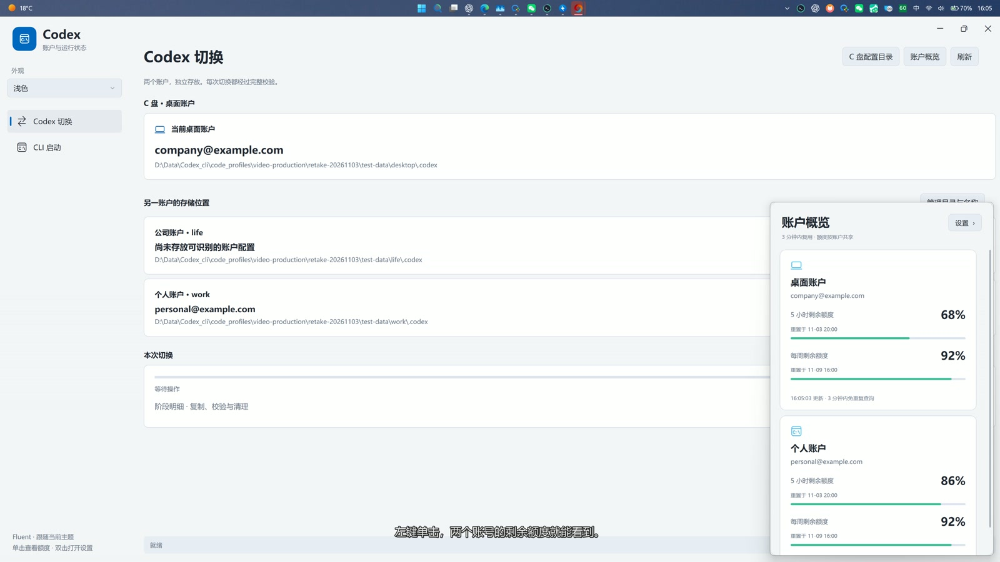

额度查询在打开面板时触发，三分钟内复用缓存；后台不进行额度定时轮询。额度圆环采用最近一次读取到的非桌面账户五小时额度，更新数据后才调整图标，无须持续刷新。

额度条采用三个区间，便于判断：

| 剩余额度 | 显示颜色 |
|---|---|
| 0%～20% | 红色 |
| 大于 20% 至 50% | 黄色 |
| 大于 50% | 绿色 |

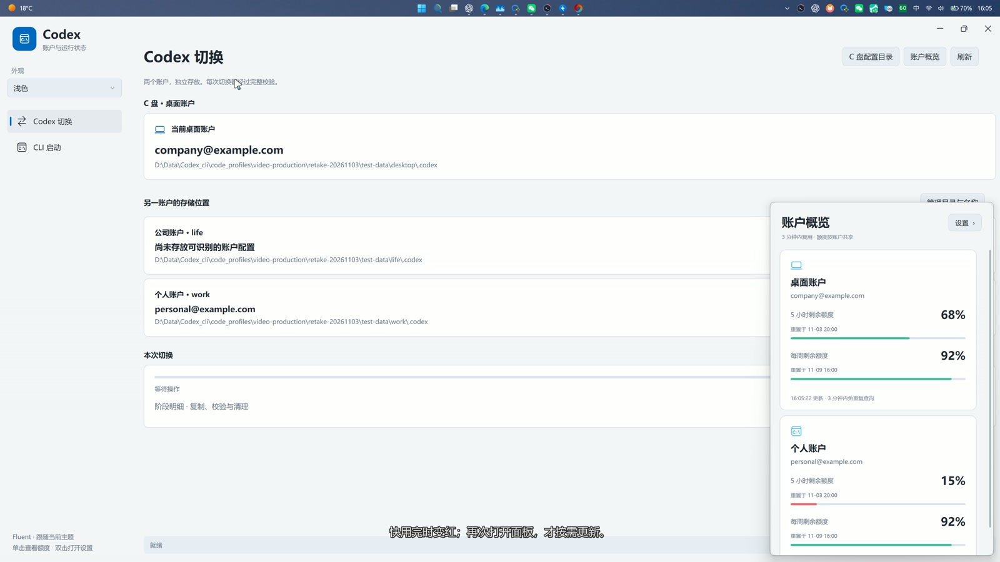

演示中额度变化用于展示颜色与图标反馈，不代表实际消耗速度。未读取到额度时显示等待或查询提示，不应把空白理解为零额度。

## 5. 右键菜单与 Windows 风格外观

右键托盘图标可访问快速预览、设置、使用说明和退出。点击外部关闭菜单，鼠标离开超过约 1.5 秒也会自动收起。

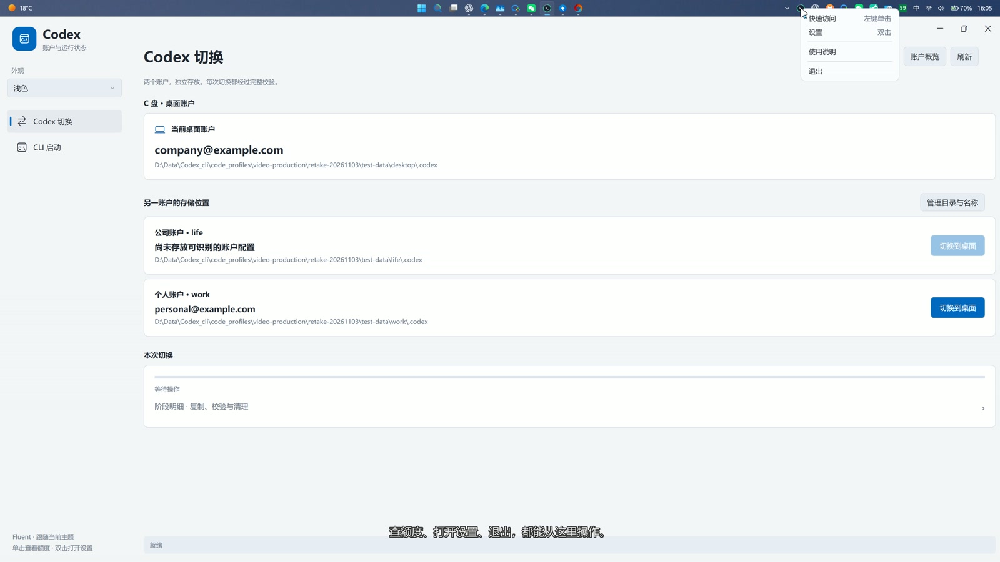

支持跟随 Windows、浅色和深色主题；圆角卡片、下拉菜单、细滚动条和窗口按钮保持统一风格。界面采用微软雅黑，主题切换不会改变账户配置。

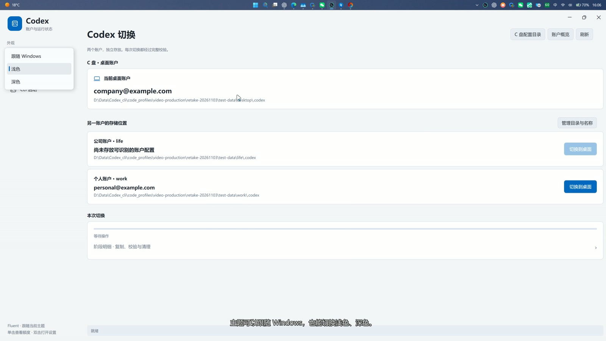

## 6. 完整目录切换，而不是只换登录文件

桌面账户的配置位于当前 Windows 用户目录下的 .codex。本工具以完整配置目录为迁移单位，将另一个账户配置切换到该位置，同时把原账户放回相应存储目录。

只替换 auth.json 虽然可能改变登录身份，但认证身份与原有会话数据不匹配时，可能遇到聊天记录空白、无权访问原会话等问题。完整目录迁移旨在让认证和本地会话资料一起切换；它不改变服务端账户权限，也不保证跨账户读取聊天内容。

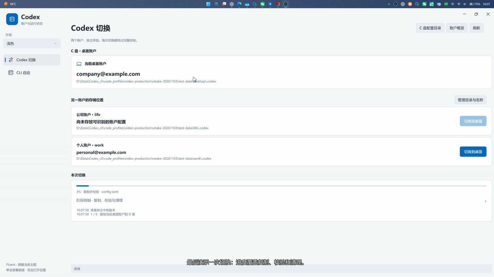

切换包含中转复制、校验、提交和清理等阶段。“本次切换”展示整个流程的进度，明细默认折叠，展开后可查看阶段与日志。未完成时可按界面继续或撤销，已进入迁移的操作需要按恢复流程处理。

继续同一次切换会保留上次保存的百分比，重新启动软件也能恢复。先校验已有副本，内容一致的文件直接复用，变化文件重新复制；校验期间进度可能暂时不增长。保存的是完整任务的百分比，不是单个文件的断点；未完成的大文件会重新复制。全部完成后恢复为新的待操作状态。

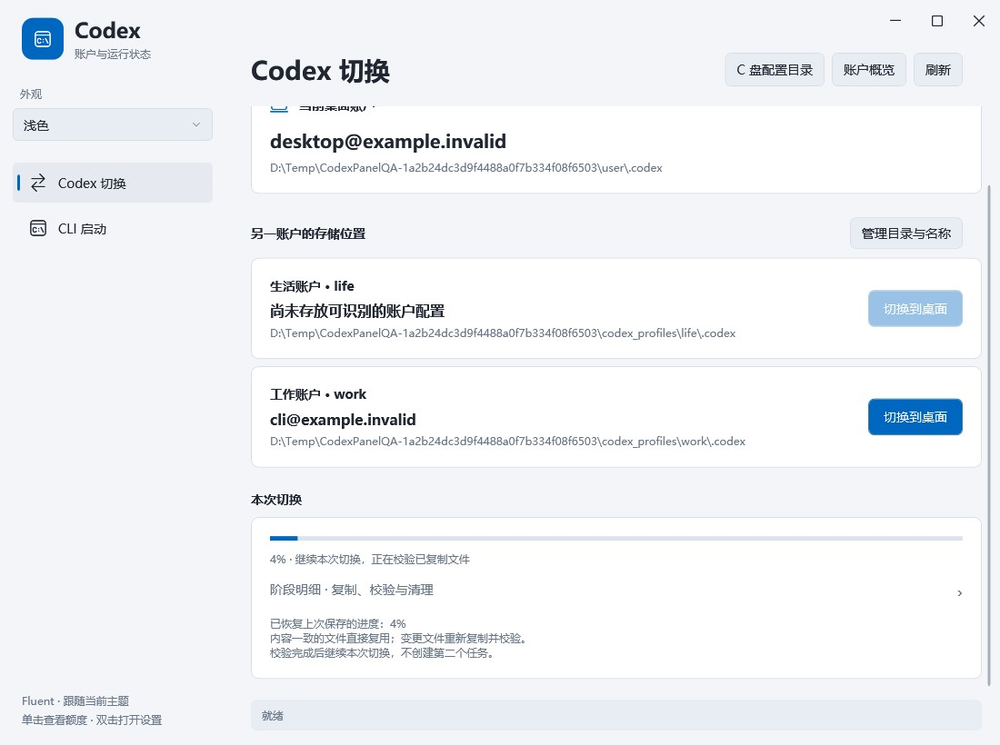

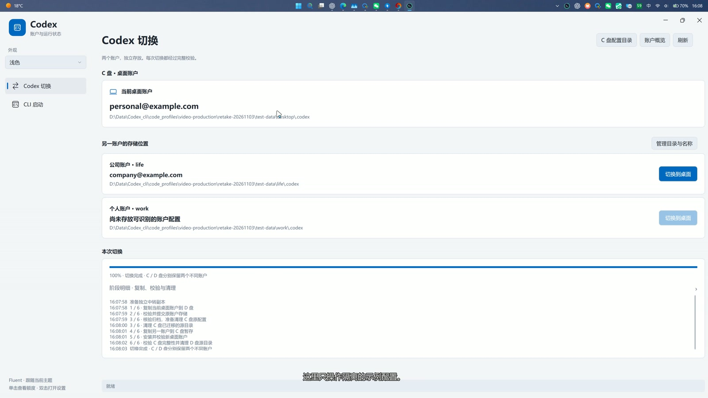

**操作前退出使用相应配置的桌面版或 CLI。**出现文件占用、权限、路径或校验错误时，应停止并按提示处理。结束进程可能中断未保存工作，请先确认。未识别到占用进程不等于目录一定可安全操作；不要绕过提示强制删除配置。

## 7. 前台与收纳后的资源占用

视频分别展示主界面打开，以及关闭界面收纳到托盘后的任务管理器读数。两种状态需要分开比较，不能用隐藏时的数值代表前台占用。

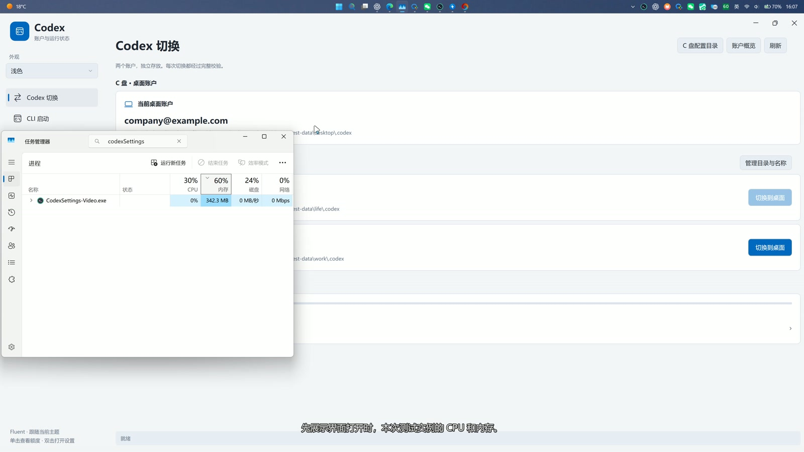

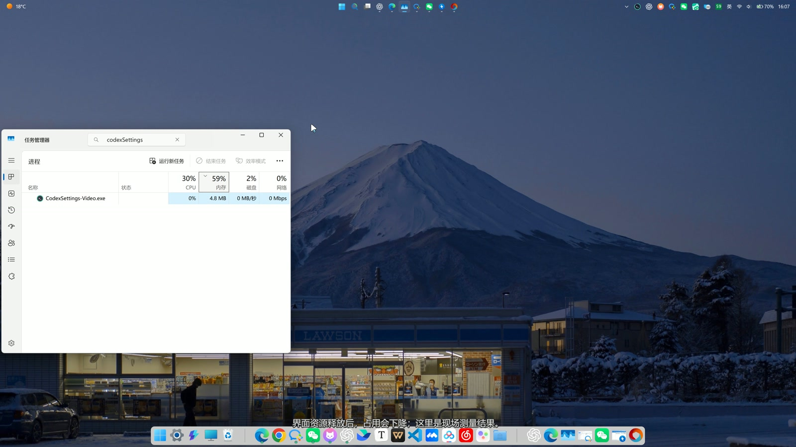

设计上按需查询额度，避免持续更新图标，并在界面关闭且没有任务时释放相关资源。以上为录制时的单次测量；机器、系统缓存、界面状态和迁移任务会影响结果，不承诺固定内存上限或零 CPU。程序未退出时仍需保留托盘及必要状态。

## 8. 下载、分享与隐私

1. 从 [Releases](https://github.com/Liu020321/CodexAccountSwitcher/releases) 下载原始便携 ZIP，解压后运行 CodexSettings.exe；或运行 Setup.exe 安装版。安装版默认安装到当前用户的 LocalAppData，无需管理员权限，可创建快捷方式。
2. 需要 Windows 11 x64、.NET Framework 4.8；Codex CLI 独立安装。
3. 首次配置账户目录，再确认桌面与 CLI 的账户身份。
4. 分享时直接发送原始 ZIP 或 Setup.exe 和校验文件，不要打包使用后的文件夹。
5. 卸载安装版只删除程序分发的文件，不删除使用后创建的账户目录、设置和日志；有未完成任务时先继续或撤销。

登录凭证、聊天资料与使用后生成的设置或日志不应公开。软件未经独立完整安全审计，尚未代码签名，不能承诺零漏洞。来源与第三方声明见 [THIRD_PARTY_NOTICES.md](../THIRD_PARTY_NOTICES.md)。
